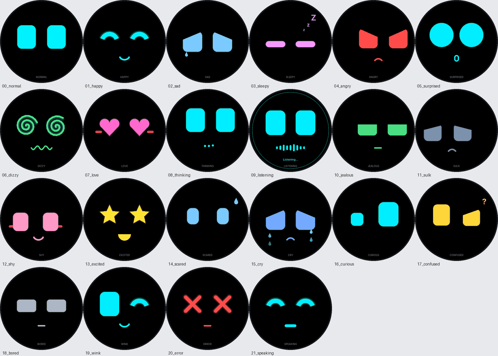
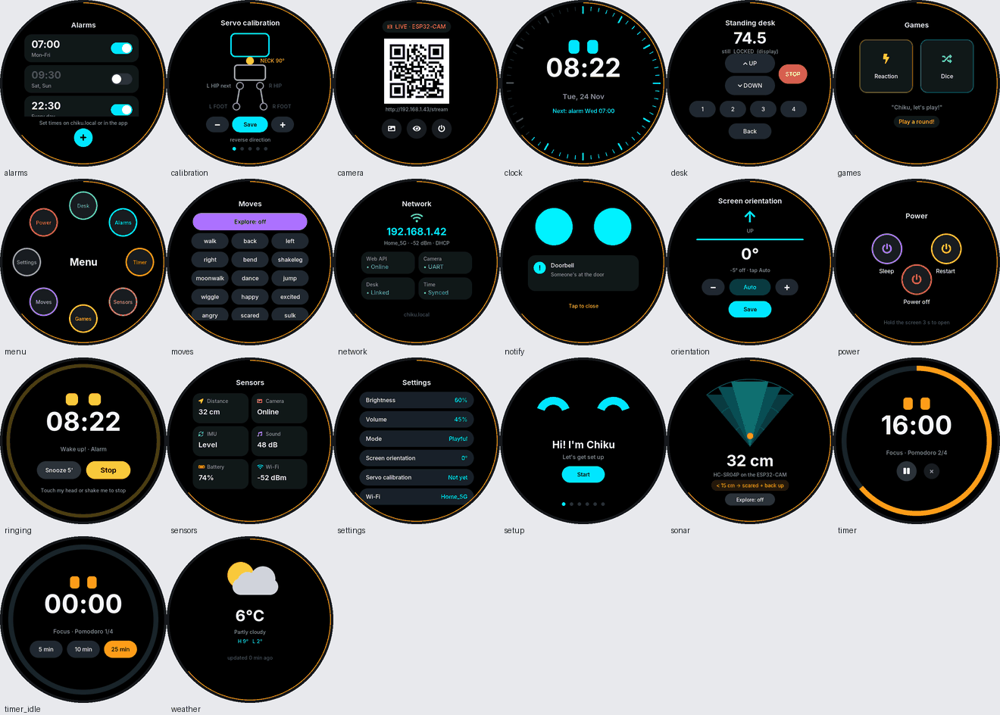
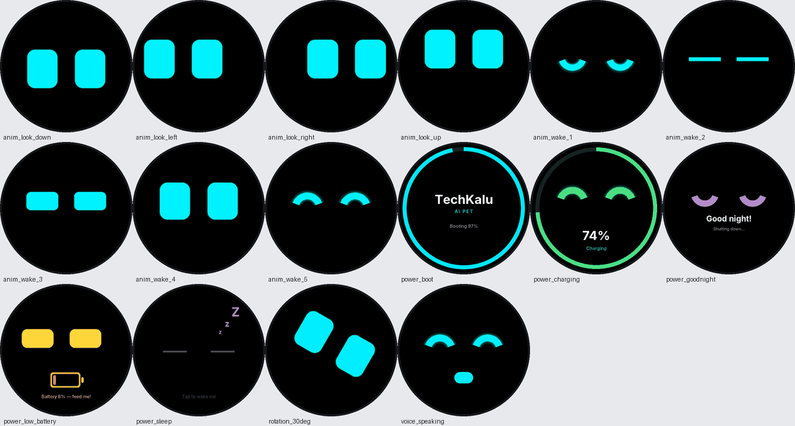

# Chiku firmware

Two firmwares in one PlatformIO project:

| Env | Board | Folder |
|---|---|---|
| `head` | Waveshare ESP32-S3-Touch-AMOLED-1.75 | `src/head/` |
| `cam` | ESP32-CAM (AI-Thinker) in the hand box | `src/cam/` |

Docs: [WIRING.md](WIRING.md) · [CALIBRATION.md](CALIBRATION.md)

## Build

```bash
pip install platformio "click<8.2"     # click 8.2+ breaks the bundled esptool
pio run -e head
pio run -e cam
pio run -e head -t buildfs             # web page image (data/)
```
Platform: pioarduino (Arduino core 3.x), LVGL 9.2.2 (Inter fonts, OFL), GFX Library for Arduino 1.5.9, SensorLib 0.3.1,
XPowersLib 0.2.7, ArduinoJson 7.2.1 (all pinned in `platformio.ini`).

PC simulator (no board needed): `bash tools/uisim/run.sh` builds the real face + screen code with LVGL on
the PC and writes every face, animation frame and screen to `tools/uisim/out/*.png` (also checks the
rotation math). See [TESTING.md](TESTING.md).

## Flash

**Head (USB-C):** hold **BOOT**, tap **PWR/RESET** (or plug in USB while holding BOOT), release BOOT, then
```bash
pio run -e head -t upload
pio run -e head -t uploadfs            # the settings web page
```
Press the reset/PWR button afterwards. Later updates can use OTA: `http://chiku.local/update`.

**ESP32-CAM (USB-TTL adapter):** wire adapter 5V->5V, GND->GND, TX->U0R, RX->U0T, and **IO0 -> GND**.
Press the cam RESET button, then `pio run -e cam -t upload`. Remove IO0-GND and press RESET again.

## UI design (UI kit)

The screens follow the Chiku UI & Motion kit: true black background (AMOLED pixels off), colour = mood
(cyan normal, pink love, yellow excited, blue sad/scared, red angry/error, purple sleepy, green OK/charging,
orange warning), cards with radius 20, Inter font (`tools/make_fonts.sh` builds `src/head/fonts/`), content
inside a 420 px circle. Pictures made by the PC simulator (`tools/uisim`):





## First setup

Power on: boot screen (logo + progress ring while Wi-Fi connects), then the **first-time setup**
(dots at the bottom show the step):

1. **Welcome**: tap Start.
2. **Wi-Fi**: scan the QR code (or join the open Wi-Fi **Chiku-Setup**), the setup page opens
   (else http://192.168.4.1). Choose your network and password. The head also sends them to the ESP32-CAM.
3. **Screen orientation**: Auto + fine-tune, see [CALIBRATION.md](CALIBRATION.md).
4. **Servos**: joint by joint, see [CALIBRATION.md](CALIBRATION.md).
5. **Mic check**: say "Hey Chiku" three times (tests the microphones; it is not a wake word yet).
6. **All set!** Saved to NVS. Settings -> First-time setup runs it again.

Then **http://chiku.local**: brightness, volume, location, alarms, timers, servo trims, feelings, screens,
rotation, camera. Time: NTP (Europe/Berlin) kept in the PCF85063 RTC. Weather: Open-Meteo (no key).

## Using Chiku (navigation)

| Input | Action |
|---|---|
| Tap the face | happy reaction (random: happy / wink / love) |
| Swipe left / right on the face | Clock, Weather, Timer (carousel) |
| Swipe up | radial menu: Desk, Alarms, Timer, Sensors, Games, Moves, Settings, Power |
| Swipe down | back (lists that scroll: swipe right = back) |
| Hold the screen 3 s | power menu: Sleep / Restart / Power off (a red ring fills while you hold) |
| Shake / tilt | angry / dizzy |
| Loud sound (microphones) | surprised |
| No input 5 / 10 min | bored, then sleepy, then the sleep screen (touch wakes, with the wake-up animation) |
| Battery < 15 % / plugged in | tired yellow eyes + "feed me!" and slower moves / green charging ring |
| Wi-Fi lost | error face for 3 s |
| `POST /api/notify` | alert screen (doorbell style) + matching emotion |

Screens: Face, Clock (tick ring, mini eyes, next alarm), Weather, Timer (5 / 10 / 25 min Pomodoro, pause,
Chiku dances at the end), Alarms (list + on/off), Alarm ringing (Snooze 5' / Stop), Moves, Sensors
(distance, camera, IMU, sound, battery, Wi-Fi), Radar (ultrasonic), Camera (stream QR, snapshot, light),
Network, Games (Reaction: tap when the eyes flash; Dice: shake to roll), Desk, Settings, Servo calibration,
Screen orientation, Power menu, Good night, Notification.

Not built from the kit (they need a Pi hub, Home Assistant or extra hardware): home hub / light /
thermostat / music screens, MQTT / TCP / Crestron / integrations screens, drop protection (TCRT5000),
accessory slot, camera games (rock-paper-scissors), wake word and speech AI.

**Five touch pads** (ears, legs, body), each with single / double / triple / long press:

| Pad | 1 tap | 2 taps | 3 taps | Long press |
|---|---|---|---|---|
| Ear (left or right) | happy, tilts head | excited dance | shy (blush, looks away) | love (sways while held) |
| Leg (left or right) | surprised hop | angry stomp | scared (trembles) | sulk (ruthna: turns away) |
| Body (middle) | happy | jealous (green side-eye) | cry (tears) | love (purr, sways) |

Chiku also has feelings that build up: petting raises affection; poking a leg again and again makes it
annoyed, then angry, then it sulks. If ignored for 2 minutes it feels lonely. It does small cute things on
its own (curious look, yawn, giggle). Edit `behavior.cpp` (`onPad`) to change anything.

## Faces and body language

22 faces (`face.cpp`, table `MOODS[]`): normal, happy, sad, sleepy, angry, surprised, dizzy, love, thinking,
listening, jealous, sulk, shy, excited, scared, cry, curious, confused, bored, wink, error, speaking.
Each is drawn from shapes (rounded eyes with lids, arcs, hearts, stars, spirals, crosses, mouths, tears, z z z)
and the numbers glide from one face to the next. Always on top: blink every 2-6 s (5 frames, 20 % double
blink), look-around every 8-15 s (eyes +-55 / +-35 px, the neck follows by up to 10 degrees), breathing,
and a talking mouth that follows the voice while Chiku speaks.

"Every emotion = face + servo pose + sound" (`behavior::express`): the face changes first, the body follows
with the pose from the kit table (`motion.cpp`, neck / hips / feet), then the sound. Error freezes and releases
the servos. Idle: the neck "breathes" +-3 degrees (`IDLE_BREATHE_DEG`, 0 = off).
The kit calls the 5th servo "neck (nod)"; on Chiku it is the head pan servo, so the neck angles turn the head.
Tune the angles in `GAITS[]` on your build.

## Voice and microphones

Chiku speaks with short recorded lines (`data/voice/*.wav`, made by `tools/make_voice.sh` with espeak-ng):
hello, happy, excited, shy, love, surprised, angry, sulk, scared, sad, jealous, alarm, timer, goodmorning.
If a clip is missing it falls back to a synthesised "cute talk" babble that matches the feeling.
Replace a clip with your own voice: web page -> Voice -> Upload (16 kHz, 16-bit, mono WAV with the same name).

The two onboard microphones (ES7210, `mic.cpp`) measure the sound level: listening bars on the face, loud
sound -> surprised, Sound tile on the Sensors screen, mic check in the setup. Not included yet: the wake word
"Hey Chiku" and speech to text (needs Espressif ESP-SR with a custom wake word model, or streaming to a server).

## Hardware self-test

Hold **BOOT** while powering on. Tests display, touch, IMU, RTC, speaker, microphones, PCA9685 (each servo
moves slowly), cam link, sonar. The report is shown on screen and on the serial port (115200). Touch to reboot.

## Code map (`src/head/`)

| Module | Job |
|---|---|
| `events` | event bus (queues), the only way modules talk |
| `bus` | shared onboard I2C with a mutex |
| `storage` | NVS settings + LittleFS |
| `display`, `rotate.h` | CO5300 + LVGL port (full frame in PSRAM), free screen rotation (any angle) |
| `face`, `face_draw` | the face: mood table, blink, look, wake-up, battery looks / drawing of every shape |
| `ui`, `ui_common.h` | screen manager + navigation / UI kit colours, fonts, cards, rings, mini eyes |
| `ui_*` | one file per screen (clock, weather, timer, menu, alarms, ringing, moves, sensors, sonar, camera, network, games, desk, settings, calib, orient, power, goodnight, notify, boot, setup) |
| `behavior` | reactions (event -> face + pose + sound), feelings, idle stages |
| `servo` | PCA9685, easing, stagger, idle power-off |
| `motion` | gaits and the kit emotion poses, obstacle stop, neck breathing |
| `imu` | shake, pick-up, tilt, tap, fall |
| `touch` | screen gestures (CST9217), turned by the screen rotation |
| `pads` | 5 touch pads: ears, legs, body; tap/double/triple/long |
| `rtc_time`, `alarm_timer`, `weather` | time, alarms (snooze) / timers (pause, Pomodoro) / stopwatch, forecast |
| `audio`, `mic` | ES8311 speaker: beeps, melodies, babble, WAV clips / ES7210 microphones: sound level |
| `sonar`, `camlink` | distance filter, UART protocol to the cam |
| `net` | Wi-Fi portal, mDNS, web API, OTA |
| `power` | dim/sleep, power off (AXP2101), battery events |
| `selftest` | BOOT-at-power-on test mode |

Tasks: UI (core 1, prio 3), actuators 50 Hz (core 0, prio 4), sensors (core 0, prio 3), audio and mic
(core 0, prio 2), network (core 0, prio 1). All tunables and feature flags: `include/config.h`.
LVGL's heap (512 KB) and the frame buffer live in PSRAM.

## How to add a face (mood)

1. `src/head/face.h`: add `M_MYMOOD` before `MOOD_COUNT`.
2. `src/head/face.cpp`: add one row at the same position in `MOODS[]`: name, colour, the two eyes
   (`RECT(w, h, radius %, lid inner %, lid outer %, dx, dy)` or `SHAPE(K_HEART, size, dy)`), mouth, extras,
   forced look, blink.
3. `src/head/behavior.cpp`: add the matching row to `EMO[]` (pose, cycles, sound).
4. Trigger it: `behavior::express(face::M_MYMOOD);` (face + pose + sound) or `face::setMood(face::M_MYMOOD, 2000);`.
5. Add the name to the lists in `data/index.html`, `RobotApp/src/api/catalog.ts`, `RobotApp/tools/mock-robot.mjs`
   and `Bringup/lib/robothttp.py`, then check it with the simulator.

## How to add a gait or pose

1. `src/head/motion.h`: add `G_MYGAIT` before `G_COUNT`.
2. `src/head/motion.cpp`: add a row to `GAITS[]` at the same position:
   `{"name", {amp x5}, {offset x5}, {phase x5}, period_ms, ramp_ms, flags}` for left hip, right hip,
   left foot, right foot, neck (degrees around 90, phase in degrees). Flags: `F_HOLD_END` keeps the pose,
   `F_RELEASE_END` then switches the servos off.
3. Run it with `events::publish(events::EV_MOTION_CMD, motion::G_MYGAIT, cycles);` (it shows up in the
   Moves screen by itself).

## How to add a screen

1. Write `src/head/ui_myscreen.cpp` with `create`, `update(dt)`, `onShow`, `onHide` (copy a small one,
   e.g. `ui_network.cpp`) and add `UI_SCREEN(ui_myscreen)` to `ui_screens.h`.
2. `src/head/ui.h`: add `S_MYSCREEN` before `S_COUNT`; `ui.cpp`: add one `SCR(...)` row at the same position
   (name for the API, parent for "back", gesture mode).
3. Open it from the menu (`ui_menu.cpp`) or a settings row, and add it to the simulator run.

## Camera protocol (UART, JSON lines, 115200)

```
head -> cam  {"cmd":"snap"} {"cmd":"led","on":true} {"cmd":"sleep"} {"cmd":"wake"}
             {"cmd":"ip"} {"cmd":"wifi","ssid":"..","pass":".."}
cam -> head  {"evt":"ready"} {"evt":"ip","ip":"1.2.3.4"} {"evt":"dist","cm":42}
             {"evt":"snap","ok":true,"len":12345} {"evt":"cam","state":"on|sleep"}
```
Stream `http://<cam-ip>/stream`, snapshot `http://<cam-ip>/capture`. The camera powers down after 30 s without a viewer.

## Notes

* Weather HTTPS uses `setInsecure()` (public data, no secrets). Pin a certificate if you prefer.
* Not tested on real hardware when this was written: please run the self-test first and report failures.
